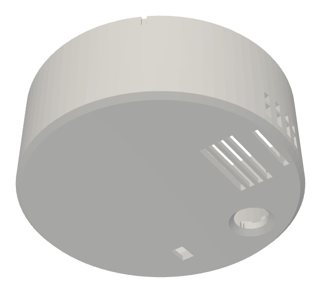
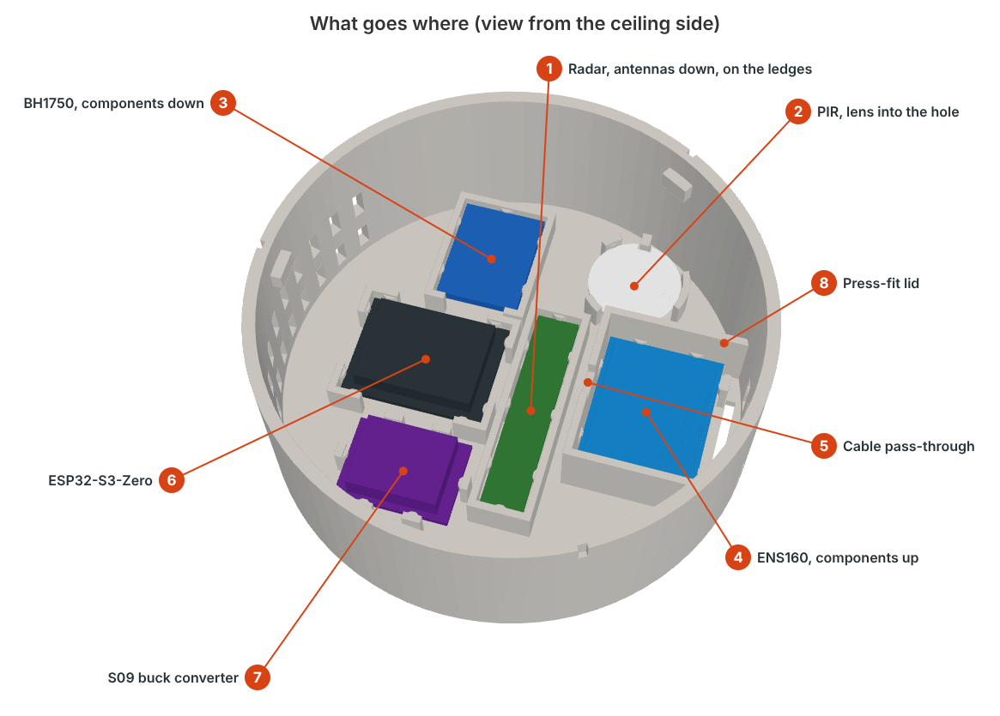
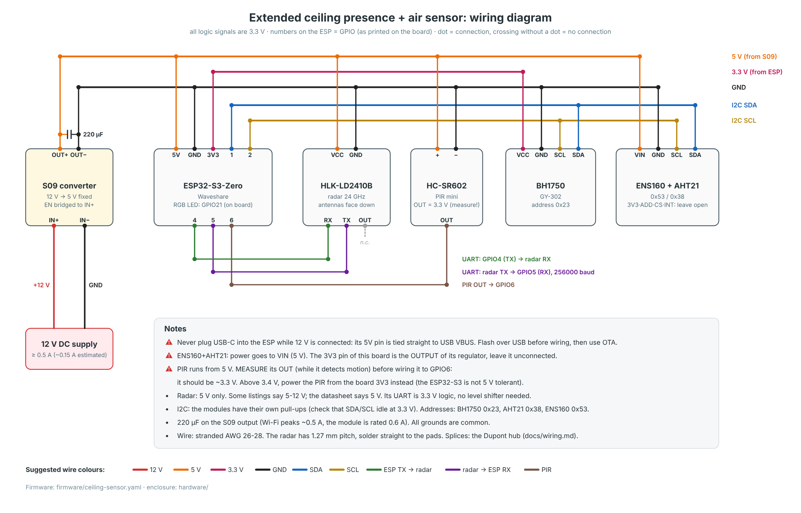

# Extended ceiling presence + air sensor

A small ceiling-mounted sensor for Home Assistant, about the size of a smoke detector (Ø80 × 30 mm, or Ø100 if you want more room inside). One per room. It tells you whether someone is in the room, even if they're sitting still, and how the air is doing.



It combines:

- 24 GHz mmWave radar (HLK-LD2410B) for presence, including people who aren't moving
- PIR (HC-SR602) for fast motion detection when someone walks in
- ENS160 + AHT21 for air quality (eCO2, TVOC, AQI), temperature and humidity, in a separate ventilated chamber so the electronics don't heat the sensors
- BH1750 light sensor, so lights only come on when it's actually dark
- ESP32-S3-Zero running [ESPHome](https://esphome.io), powered from 12 V

Parts cost about 100 zł (~€24) from AliExpress or about 160 zł (~€38) from a single seller on Allegro in Poland. The enclosure prints in PETG without supports and every board is held by press-fit crush ribs, so there are no screws inside and glue shouldn't be needed.

## Project status

| Part | Status |
|---|---|
| Firmware | Validates and compiles with ESPHome 2026.10.0. Not yet confirmed on a finished unit. |
| Electronics | Wiring designed around these modules. Do the bench test from [assembly](docs/assembly.md) before closing the box. |
| Enclosure Ø100 (v12, [`hardware/d100/`](hardware/d100/)) | v9 was printed in PETG and test-fitted. It showed a loose ESP, PIR and chamber lid; those fixes and the taller chamber are in, but the current files haven't been reprinted. |
| Enclosure Ø80 (v12, current) | Includes the fixes from that print and keeps the same calibrated seats. v12 makes the ENS160 chamber 10 mm taller so pin headers with push-on jumper wires fit. **The full housing hasn't been printed yet**, so print `11_seat_test_fit.stl` first. |

Issues and photos of your build are welcome.

## Documentation

1. [Bill of materials](docs/bom.md): modules with Allegro and AliExpress links, passives, screws
2. [Wiring](docs/wiring.md): diagram, pin map, power notes
3. [Printing](docs/printing.md): filament, slicer settings, print order, fit calibration
4. [Firmware and Home Assistant](docs/firmware.md): flashing ESPHome, adding the device, entity list
5. [Assembly](docs/assembly.md): modules into seats, ceiling mount
6. [Tuning and automations](docs/tuning.md): radar range, temperature offset, example automations
7. [Enclosure source](docs/enclosure-source.md): parametric CadQuery model, parameters, measured sizes

## Quick start

1. Buy the parts from the [BOM](docs/bom.md). Stick to the exact module types, because the seats are sized to them.
2. Print `10_press_fit_calibration.stl` and `11_seat_test_fit.stl` from [`hardware/stl/`](hardware/stl/), check the fit, then print `00_print_plate_all_parts.stl`.
3. Flash [`firmware/ceiling-sensor.yaml`](firmware/ceiling-sensor.yaml) over USB and wire everything on the bench.
4. Check in Home Assistant that every sensor reports, then assemble and mount it.
5. Tune the radar range and the temperature offset.





## Repository layout

```
firmware/        ESPHome config + secrets template
hardware/stl/    printable parts, Ø80
hardware/step/   the same parts as STEP
hardware/source/ CadQuery model and the wiring diagram generator
hardware/d100/   printable parts, Ø100 (STL + STEP)
homeassistant/   example automations
docs/            documentation and images
```

## Limitations

- eCO2 from the ENS160 is **estimated from VOCs**, not measured. It's fine for "the room is stuffy, open a window", not for exact ppm. If you need real CO2, add an SCD40 or MH-Z19C.
- There is no particulate (PM2.5) sensor.
- The radar sees through thin walls. Limit its range in Home Assistant, see [tuning](docs/tuning.md).

## License

[MIT](LICENSE): firmware, CAD source, models and docs.
