# Assembly

## 0. Bench test first

Before anything goes into the housing:

1. Flash the firmware over USB (see [firmware](firmware.md)).
2. Solder 8-10 cm wires to every module and wire everything up on the desk as in [wiring](wiring.md).
3. Power it from 12 V and check in Home Assistant that every sensor reports: occupancy, radar distances, illuminance, temperature, humidity. eCO2, TVOC and AQI stay empty for the first few minutes, and on the very first power-on for about an hour while the ENS160 runs its initial start-up.

Once the housing is closed the USB-C port is out of reach, so this is the moment to fix wiring mistakes.

## 1. Modules into their seats

A real Ø80 print with all modules in place (ceiling side; in the first photo the ENS160 chamber is at the bottom, so the picture is turned 90° compared with the render below):

| | |
|---|---|
| 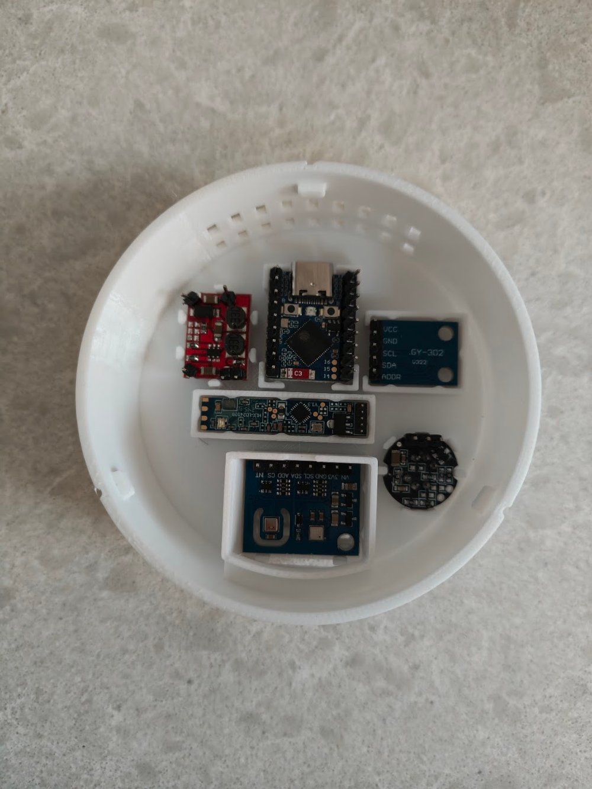 | 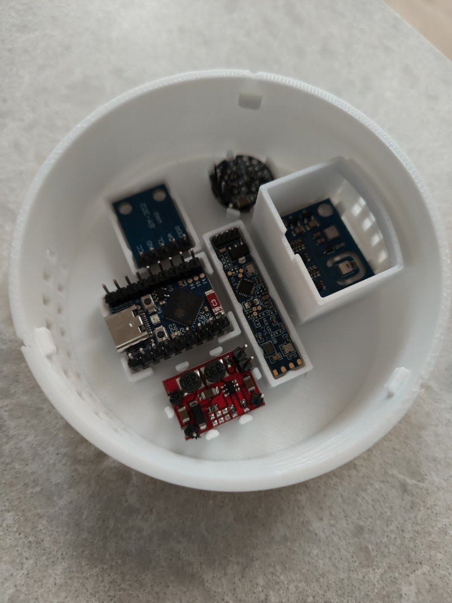 |

Seen from the ceiling side (the open side of the housing), the layout is: ENS160 chamber along the right wall, the long radar board running top to bottom just left of the chamber, ESP32-S3-Zero and the S09 converter on the left next to the side vents, BH1750 top left, PIR top right.

Each board sits on ledges and is gripped by small crush ribs. Push it in straight with a thumb; it should stay put without glue. If one ever works loose, a dot of hot glue on the board end fixes it.

| # | Module | How it goes in |
|---|---|---|
| 1 | LD2410B radar | Antenna side down, towards the face (the side with the gold antenna patches). The board rests on its long edges on the ledges, and the chip, LED and solder joints hang over the recess between them. Never put glue on the antenna. |
| 2 | HC-SR602 PIR | Lens into the round hole, the two flats of the board onto the two keys, header pointing left (towards the BH1750) over the recess in the ring. |
| 3 | BH1750 (GY-302) | Components down, pins towards the open side of the seat (towards the ESP), mounting holes the other way. The chip lines up with the small window in the face. |
| 4 | ENS160+AHT21 | **Components up**, flat underside on the two ledges, pin row towards the cable pass-through (5). |
| 5 | Cable pass-through | 5 × 2.5 mm slot at the top of the chamber wall for the four ENS160 wires (VIN, GND, SCL, SDA). The chamber is 23 mm tall, so a straight pin header with push-on (Dupont) jumper plugs fits standing up; soldered wires work too. |
| 6 | ESP32-S3-Zero | Bottom side down, between the four corner posts. |
| 7 | S09 converter | Bottom side down, between the posts, wires at the corners. The 220 µF capacitor goes next to it. |
| 8 | Chamber lid | Collar down, the notch in the collar over the pass-through, then press it in. To remove it, pry the edge up with a thin blade; it has no holes on purpose. |

After the lid is on, seal the pass-through around the wires with a bit of plasticine or putty so warm air from the electronics doesn't leak into the chamber.

### Why the ENS160 board faces up

The ENS160 and AHT21 sample air by diffusion, so they don't need to "look" at the grille. What matters is that the air in the chamber gets replaced and that heat from the ESP and the S09 stays out. The grille in the face is the inlet and the upper row of slots in the housing wall, a few millimetres above the board, is the outlet. The ENS160 heater and the temperature difference drive a slow flow from bottom to top around the board.

Mounted components-up, the board lies on its flat underside and the milled slot around the AHT21 (which isolates it from the ENS160 heater) doesn't touch any ledge.

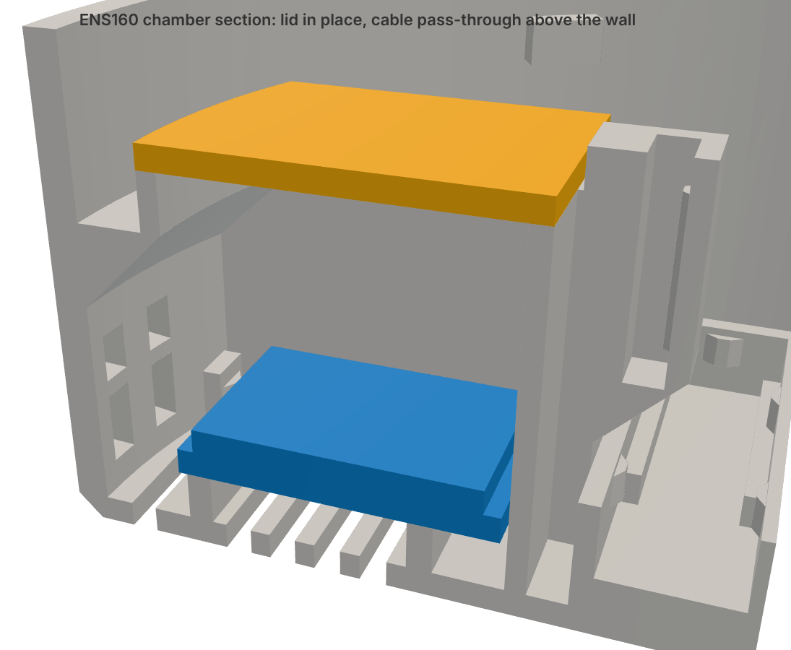

Close-ups of the seats:

| Radar | PIR | ESP32-S3-Zero | ENS160 chamber |
|---|---|---|---|
| 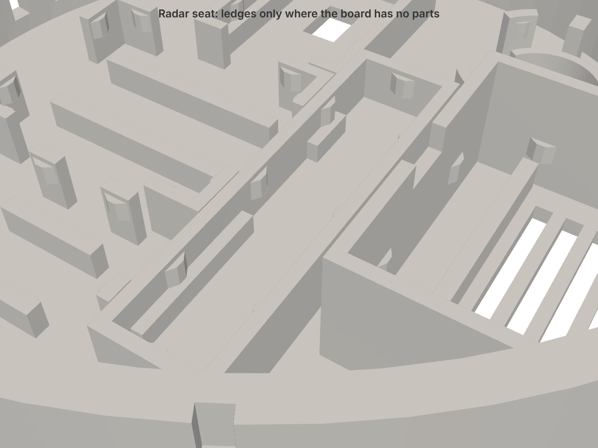 | 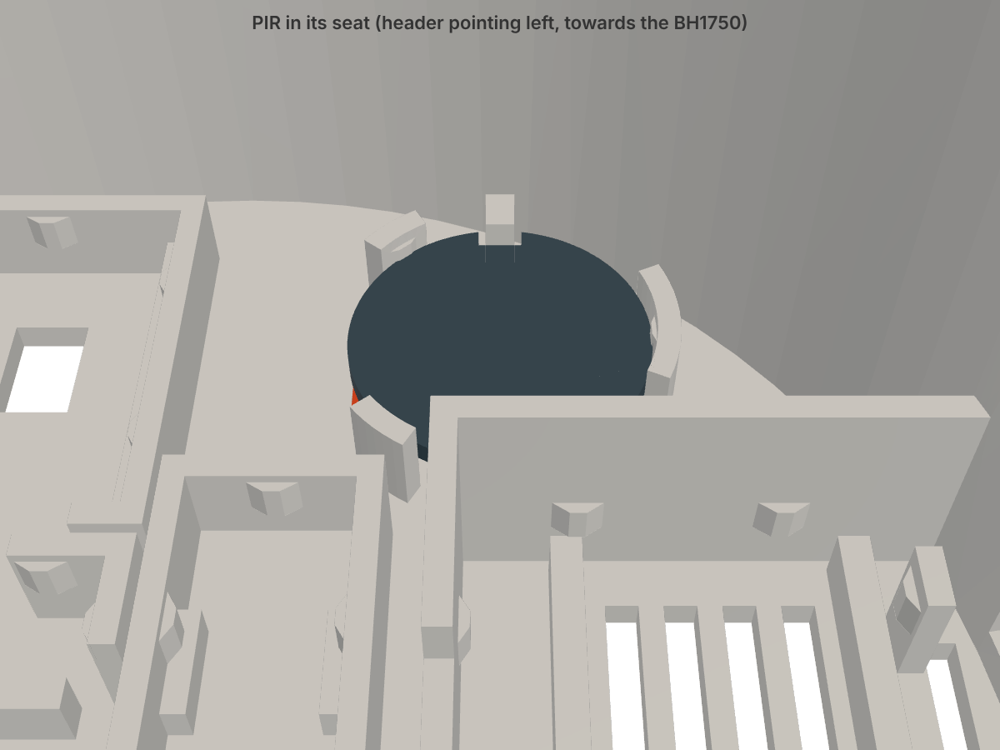 | 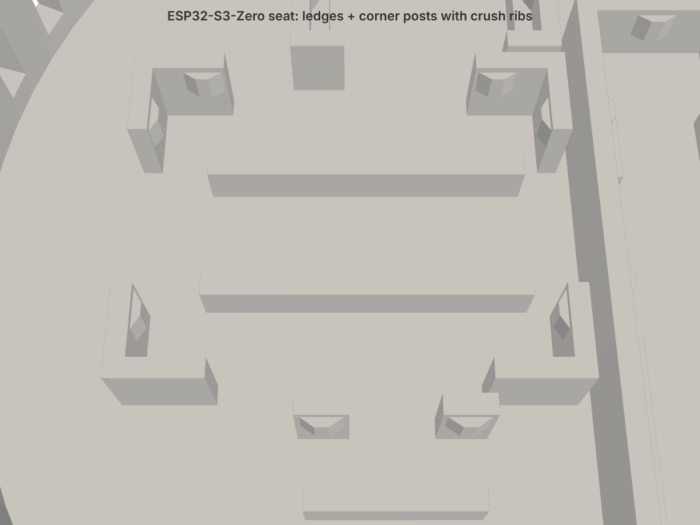 | 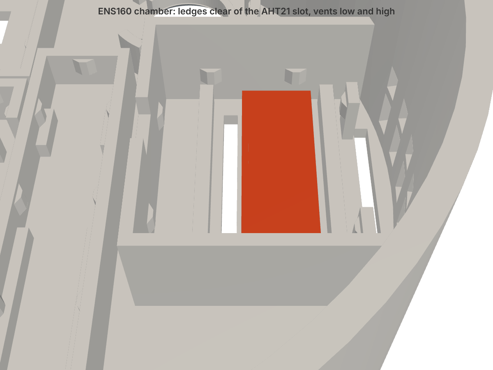 |

## 2. Wires

Route the wires flat along the face. Keep the top 10 mm along the outer wall free: that's where the ring of the ceiling base slides in. Gather the cables towards the centre, where the 12 V cable comes through the base.

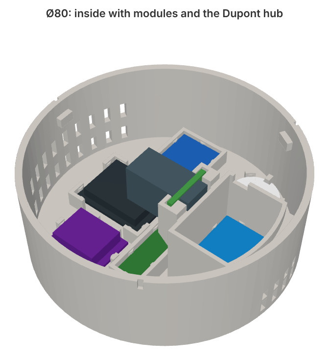

## 3. Ceiling mount

1. Screw the base to the ceiling, or onto a Ø60 flush box (60 mm hole spacing). Use countersunk screws with heads no wider than 8.6 mm: the heads clear the bayonet ring by only 0.3 mm. Feed the 12 V cable through the centre hole.
2. Optional: stick a ~1 mm foam strip on the housing rim so it sits flush against an uneven ceiling.
3. Connect 12 V through the Wago/JST connector and tie the cable for strain relief.
4. Line up the marks on the housing edge with the groove entries in the base ring.
5. Push the housing up against the ceiling and turn it about 25° **counter-clockwise, looking up at it from below**.
6. Let go. The housing drops 0.8 mm and the detent stops it from turning back. To take it off: push up, turn clockwise, pull down.

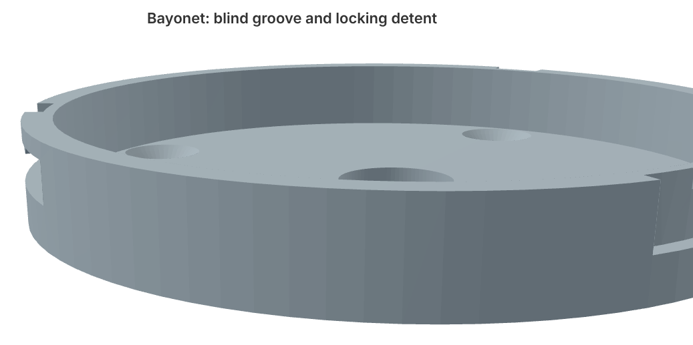

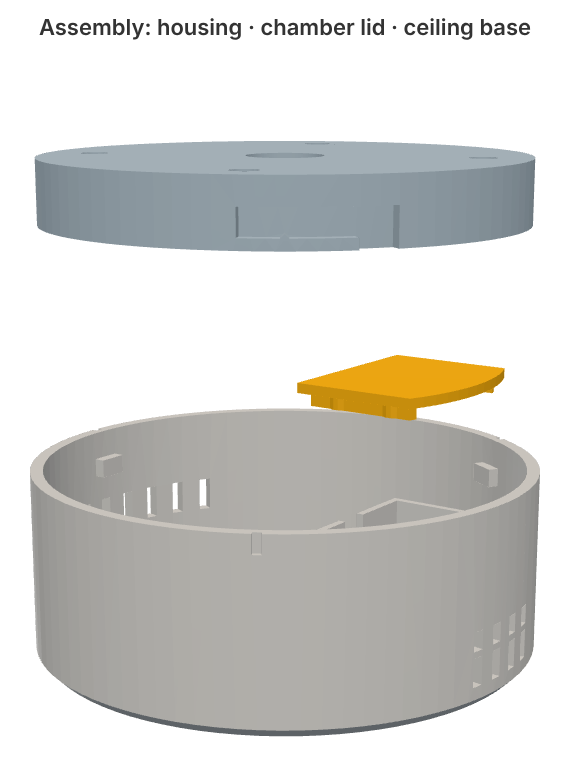

## Where to mount it

- In the middle of the room, away from ventilation outlets, the kitchen hob and direct sunlight on the face.
- The radar looks straight down. At a normal 2.5-2.7 m ceiling the floor is in gate 3 (one gate is 0.75 m). The radar also sees through thin walls, so limit its range in [tuning](tuning.md).
- The HC-SR602 has a ~100° cone. From 2.6 m that covers a circle about 3 m in radius.
- Air under the ceiling is often warmer than at head height. Calibrate the temperature offset after a day, see [tuning](tuning.md).

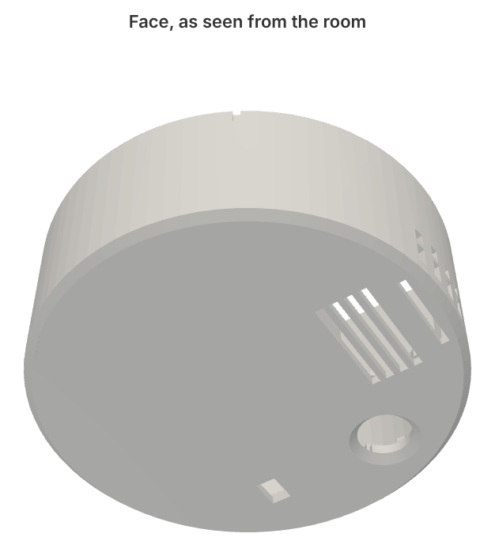
