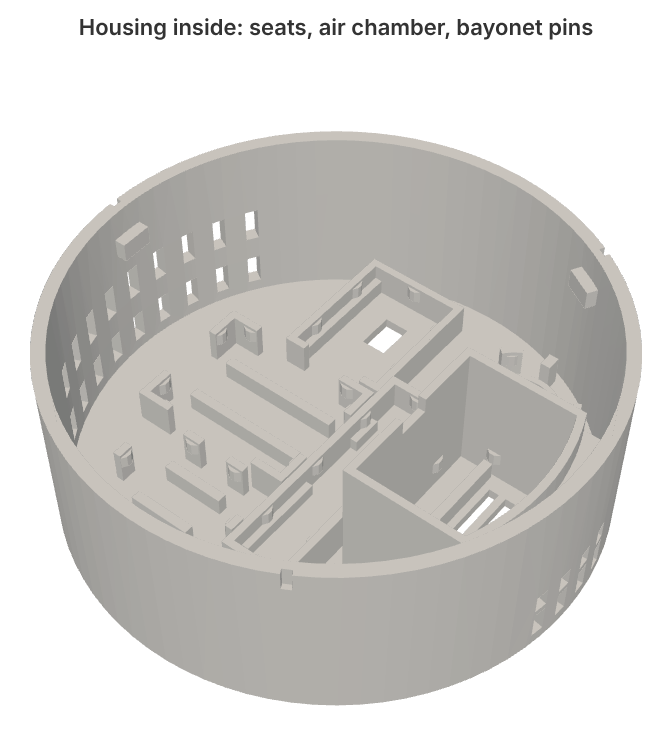

# Enclosure source

The enclosure is a parametric [CadQuery](https://cadquery.readthedocs.io) script: [`hardware/source/enclosure.py`](../hardware/source/enclosure.py). Every STL and STEP file in this repo is generated by it, so if something doesn't fit your boards or your printer, change a number and regenerate instead of editing meshes.

## OpenSCAD version (easiest way to adapt the seats)

[`hardware/source/enclosure.scad`](../hardware/source/enclosure.scad) is a port of the same model to OpenSCAD, so you can change it from the Customizer without any Python:

1. Open it in [OpenSCAD](https://openscad.org) (2021.01 or newer; a recent development snapshot with the Manifold backend renders in well under a second instead of ~10-25 s).
2. Window → Customizer. Pick `size` (80 or 100) and `part` (housing, ceiling_base, chamber_lid, print_plate, seat_test_fit, press_fit_calibration, radar_window_samples).
3. The Dupont hub has its own tab too (board size in holes, gap behind it, on/off), and the ENS160 chamber tab sets which side wall the cable pass-through is in.
4. Each module has its own tab: Radar, PIR, BH1750, ESP32-S3-Zero, Buck (S09), ENS160+AHT21. Type in the caliper size of your board (and for the PIR the diameter, the width across the notches and the lens diameter). Walls, crush ribs, ledges and windows follow automatically. `*_rib_extra` tightens one seat without touching the others, and `*_pos_80` / `*_pos_100` move a seat if a bigger board no longer fits where it was.
5. Render (F6) and export STL (F7).

With the default values it produces the same parts as the CadQuery script: the difference is only how finely the curves are faceted (under 0.7 % of the volume at the default resolution, falling to ~0.03 % at resolution 512).

If you make a board noticeably bigger, check that its seat still clears its neighbours and the side wall (render `seat_test_fit` and look from above).

## Regenerating with CadQuery

```bash
python -m venv .venv
. .venv/bin/activate
pip install cadquery
cd hardware/source
python enclosure.py          # Ø80, ~40 s, writes STL + STEP into ./out
python enclosure.py 100      # Ø100, same files with a _d100 suffix
# copy out/0*.stl and out/1*.stl to ../stl/ (Ø80) or ../d100/stl/ (_d100 files), same for .step
```

Besides the printable parts, `out/` also gets `_dummy_*.stl` (simple blocks the size of each module, for checking clearances) and `_section_*.stl` (quarter cuts used for the section image). They aren't meant for printing.

The wiring diagram comes from `python wiring_diagram.py wiring.svg`. The PNG in `docs/images/` is that SVG exported from a browser; `rsvg-convert -z 1.5 wiring.svg -o wiring.png` gives the same result.

The STEP files open in FreeCAD, Fusion and most other CAD tools if you prefer to edit there.

## Design in short

- Housing: Ø80 × 30 mm. The face (towards the room) is 1.6 mm thick, 0.8 mm in front of the radar. It prints face down without supports.
- Ceiling base with a 10 mm ring and three blind bayonet grooves. The housing has three pins at 60°, 180° and 300°, placed so that none of them sits over the air chamber. Twist 25° to lock; a small triangular detent stops it from turning back.
- Seats: every board rests on ledges, so pin stubs and components underneath have room. Seat walls and posts stand 0.4 mm away from the board on each side; only the trapezoid crush ribs touch it. The ribs are 2.4 mm wide at the base with a 0.8 mm flat top, large enough that a 0.4 mm nozzle actually prints them. In an earlier version they were 1.0 × 0.35 mm and the slicer simply dropped them.
- ENS160 chamber: a closed box along one wall with its own face grille (inlet) and slots above the board (outlet), a press-fit lid with crush ribs on the outside of its plug, and an 8 × 4 mm pass-through for the four jumper wires (VIN, GND, SCL, SDA). It is 23 mm tall so jumper plugs on a pin header fit. Above 19.5 mm its outer wall steps in at 45° (prints without support) to stay clear of the ceiling base ring. It keeps the warm air from the ESP and the S09 converter away from the temperature and VOC sensors.



## Parameters you are most likely to touch

All values in millimetres.

| Parameter | Default | What it does |
|---|---|---|
| `RIB_INTERF` | 0.13 | How far each crush rib reaches into the board outline. Set it from the result of `10_press_fit_calibration` (0.1 was a touch loose on the reference printer, 0.2 too tight). |
| `CLR` | 0.8 | Total gap between the seat walls/posts and the board. |
| `RIB_W`, `RIB_TOP`, `RIB_H` | 2.4, 0.8, 2.0 | Crush rib base width, flat-top width and height. |
| `SIZE`, `H`, `FACE` | 80, 30, 1.6 | Housing diameter (80 or 100, from the command line), height, face thickness. Each size has its own module positions (`cx`/`cy` below); another diameter needs a new layout. |
| `SCREW_SPACING`, `CSK_D` | 60, 8.6 | Base screw spacing and countersink diameter. |
| `LOCK_ANGLE`, `PIN_ANGLES` | 25, (60, 180, 300) | Bayonet twist and pin positions. |
| `CH_X`, `CH_TOP` | 12, 23 | Inner wall of the ENS160 chamber and its height (= underside of the lid). Above `Z_STEP` the outer wall steps in to `R_UP` to clear the base ring; `CH_TOP` can go up to about 25: the lid has to stay below the base plate, which sits 2.5 mm inside the housing rim. |
| `WIRE_W`, `WIRE_D` | 5.0, 2.5 | Chamber cable pass-through size. |
| `WIRE_SIDE`, `WIRE_XC` | 1, CH_X + 4.7 | Which chamber side wall the pass-through is in (+y / -y) and where along it. |
| `HUB` | cols 6, rows 5, back_gap 3.5, slack 0.8, z_min 10.0 | Dupont hub seat: the perfboard size in holes, the gap behind it for pin stubs, side play in the channels, lowest board position. The board height is raised automatically where the channels pass over the radar seat (Ø80). |
| `CAL_VALUES` | (0.1, 0.2, 0.3, 0.4) | Interference values on the calibration print. |

Each module has a dict with its measured size (`x`, `y`) and its position in the housing (`cx`, `cy`, looking from the ceiling side), plus a few specific keys:

| Dict / key | Default | Meaning |
|---|---|---|
| `RADAR["win_t"]` | 0.8 | Plastic in front of the antenna. Was 3.7 (half a wavelength in PETG) up to v14, which made the radar see noise on every gate, see [printing](printing.md#the-radar-window). |
| `RADAR["win_mx"]`, `RADAR["win_my"]` | 3.0, 1.5 | How far the thin window reaches past the radar posts in x and y. |
| `RADAR["gap"]` | 6.2 | Air between the window and the board: half a wavelength at 24 GHz. |
| `RADAR["board_t"]`, `RADAR["snap"]` | 1.0, 0.5 | Radar PCB thickness and how far the snap lips reach over its edge. The lips close 0.15 mm above the board; if your board is thicker, raise `board_t`. |
| `RADAR["rib_extra"]` | 0.02 | Extra crush-rib interference for the radar on top of `RIB_INTERF`. |
| `RADAR["post_y"]` | (11.0, 27.5) | Long-side posts, measured from the end without the connector. Each has a small tab under the board edge and a snap lip over it; keep them off the components at the board edge (antenna side 15.5-24.5 and 30.5-35 mm, a chip on the back at about 2-7 mm). |
| `RADAR["ledge_segments"]` | ((1, 15), (25, 30)) | Where the ledges support the radar, measured from the end without the connector. The gaps leave room for components on the board edge. |
| `PIR["lens_d"]` | 10.3 | Lens hole: lens diameter at its base + 0.3. |
| `PIR["hdr_angle"]` | 180 | Direction the PIR header points (degrees). The seat rotates with it. |
| `BH["chip_dy"]` | 2.5 | Offset of the BH1750 chip from the board centre, towards the mounting holes. The light window follows it. |
| `ESP["rib_in"]` | 3.0 | Rib distance from the corners. The ESP32-S3-Zero has rounded corners, so ribs too close to them grip nothing. |
| `BUCK["rib_extra"]` | 0.05 | Extra interference for the S09 converter on top of `RIB_INTERF`. |
| `BH["rib_extra"]` | 0.05 (Ø80), 0 (Ø100) | Extra interference for the BH1750. The Ø80 seat printed loose while the identical Ø100 seat was fine. |
| `ENS["rails"]` | (4.5, 18.0) | Ledge positions measured from the pin edge, chosen to stay clear of the AHT21 slot. |

## Measured module sizes

These are the caliper measurements the seats are built on. If your boards differ, put your numbers into the dicts.

| Module | Size | Faces the room with |
|---|---|---|
| HLK-LD2410B | 35.06 × 7.0 | antenna side |
| HC-SR602 | Ø15.89, 13.65 across the flats | lens |
| GY-302 (BH1750) | 18.53 × 14.05 | components |
| ESP32-S3-Zero | 23.69 × 17.98 | underside |
| S09 converter | 18.75 × 13.95 | underside |
| ENS160+AHT21 | 24.20 × 19.29 | flat underside (components face the chamber lid) |

## Version history

The header of `enclosure.py` lists every revision. In short: v2-v5 got the bayonet and module sizes right, v6-v8 moved to printable crush ribs calibrated at 0.1 mm, v9 was printed in full in PETG, and v10 fixed what that print showed (loose ESP, PIR and chamber lid, buck seat slightly loose), v11 shrank the housing from Ø100 to Ø80 with the same seats, v12 made the ENS160 chamber 10 mm taller for pin headers with jumper plugs, v13 tightened the Ø80 BH1750 seat by 0.05 mm, v14 added the Dupont hub seat on the chamber wall and moved the ENS160 pass-through to the chamber side wall, v15 thinned the radar window to 0.8 mm, and v16 put the radar on posts 6.2 mm above it, widened the ENS160 pass-through to 8 × 4 mm and raised `RIB_INTERF` to 0.13 mm. In the v16 seat test the radar fell out, so v17 added snap lips on the long-side posts; v18 moved one pair of them off a chip on the back of the board and raised the hub 0.8 mm to clear them. v12 also generates both sizes from one file: the Ø100 layout is selected with `python enclosure.py 100` and lives in [`hardware/d100/`](../hardware/d100/).
