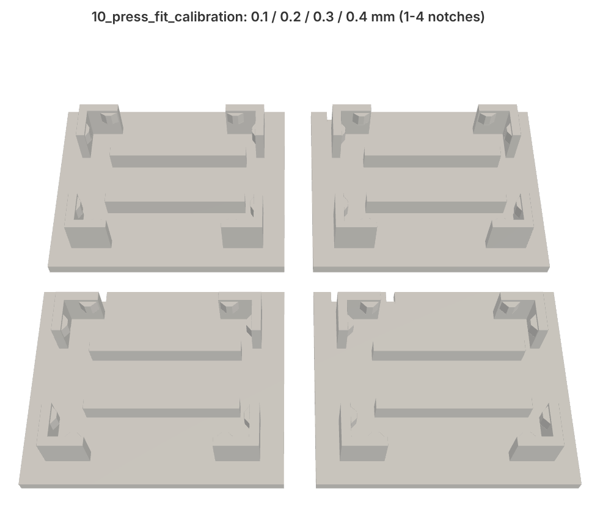
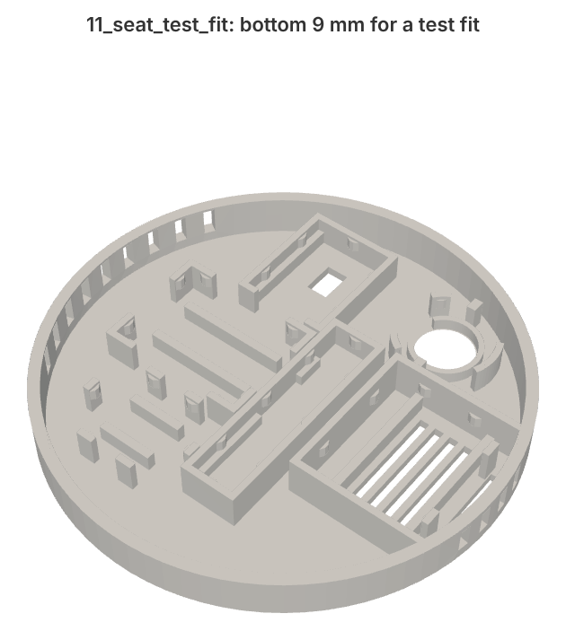

# Printing

All parts print without supports. The Ø80 files are in [`hardware/stl/`](../hardware/stl/) (STEP in [`hardware/step/`](../hardware/step/)); the Ø100 set is in [`hardware/d100/`](../hardware/d100/) with a `_d100` suffix. Calibration and radar window prints are shared by both sizes.

## Filament

PETG. White looks best on a ceiling.

Avoid anything with metal or carbon fibre in it. The radar looks through the face of the housing, and conductive fillers block 24 GHz. PLA works mechanically, but PETG handles the warm air under a ceiling better and the press-fit ribs were tuned in PETG.

## Settings

The default **0.16 mm** profile of QIDI Studio / Orca Slicer for PETG works fine, which is what the reference prints used. If you set it up by hand:

| Setting | Value |
|---|---|
| Layer height | 0.16 mm (0.2 mm also works) |
| Walls / perimeters | 3 |
| Infill | 15-20 %, any pattern |
| Supports | off |
| Brim | not needed; add one if your PETG lifts at the corners |
| **X-Y hole compensation / X-Y contour compensation** | **0** |

The last row matters. The seats rely on crush ribs that overlap the board outline by only 0.13 mm. Any slicer-side XY compensation changes that overlap and the boards end up either loose or impossible to push in.

## What to print, in order

| File | What it is | Orientation |
|---|---|---|
| `10_press_fit_calibration.stl` | Four ESP32-S3-Zero seats with 0.1 / 0.2 / 0.3 / 0.4 mm rib interference (1-4 notches on the edge) | flat, as exported |
| `11_seat_test_fit.stl` | The bottom 9 mm of the housing with every seat, for a test fit of all modules | face down |
| `00_print_plate_all_parts.stl` | Housing + ceiling base + chamber lid laid out on one plate (164 × 116 mm) | as exported |
| `01_housing.stl` | Housing: face, module seats, closed ENS160 chamber, three bayonet pins | face down |
| `02_ceiling_base.stl` | Ceiling base: 4 screw holes on a 60 mm spacing, Ø12 hole for the 12 V cable, bayonet ring | ceiling side down |
| `03_chamber_lid.stl` | Lid for the ENS160 chamber, pressed in from the top | plate down, collar up |
| `13_radar_seat_test.stl` | The radar seat with the face around it (24 × 43 mm, about 15 minutes), for the radar check below | face down |
| `12_radar_window_samples.stl` | Three plates 0.8 / 1.6 / 3.7 mm (1/2/3 notches); no longer needed, kept for experiments | flat |

1. Calibration first. Push an ESP32-S3-Zero into each of the four seats of `10_press_fit_calibration`. Pick the one where the board holds firmly but still goes in with a thumb, without shaving the ribs. On the reference printer (QIDI, PETG, 0.16 mm) 0.1 mm held every board but a touch loosely and 0.2 mm would not go in, so the STLs use **0.13 mm**. If yours prefers something else, regenerate the parts with that `RIB_INTERF` (see [enclosure source](enclosure-source.md)).
2. Seat test. Print `11_seat_test_fit` and put every module in. Check that the radar's edge components fall between the ledges, that you can see the black BH1750 chip through its window from the outside, and that the PIR notches sit on the two keys.
3. Full set. Print the plate, or the three parts separately.

## The radar window

Most of the face is 1.6 mm. In front of the radar it is 0.8 mm, over the board and a few millimetres around it. The board stands 6.2 mm above it on six thin posts (two on each long side, one at each end), with a small tab under the board edge at the four long-side posts and nothing else around it.

Up to v14 the window was 3.7 mm, meant as half a wavelength of 24 GHz in PETG. On the prototype in a kitchen that made things much worse. With the room empty, `Radar gN move energy` sat at 40-60 on every gate from g2 to g8, and still energy at 90-100. Out of the housing, on the same supply and in the same spot, the same radar gave 1-9. Hi-Link's guidance for a half-wave window also asks for a gap of 6.2, 12.4 or 18.6 mm between the antenna and the plastic; with 2 mm, the reflection from a thick window comes straight back into the receiver. Their alternative is a window of 1/8 wavelength or thinner (about 1 mm in PETG). v15 switched to 0.8 mm; v16 also lifts the board to 6.2 mm (half a wavelength in air) and replaces the walled pocket with posts, so there is as little plastic near the antenna as possible.

Before printing the whole housing, print `13_radar_seat_test.stl`, put the radar in it exactly as it goes into the housing, and compare the empty-room gate energies with the radar lying bare (see [tuning](tuning.md#radar-range)). If they are close, print the housing. Keep the radar's wires leaving from the back of the board, not running across the antenna side.
