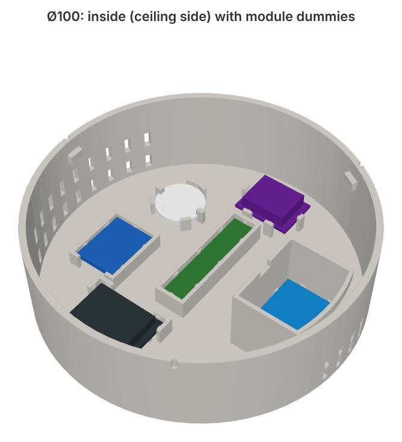

# Ø100 version

The same sensor in a Ø100 × 30 mm housing: same modules, same wiring, same firmware, same seats and press-fit ribs as the Ø80 version, and the same 23 mm tall ENS160 chamber. The bigger housing leaves more room for wires and covers a bigger patch of ceiling.

The modules sit differently than in the Ø80 pictures. Seen from the ceiling side:

- ENS160 chamber along the right wall
- radar running top to bottom in the middle
- S09 converter top centre
- PIR top left, header pointing down (towards the BH1750)
- BH1750 on the left
- ESP32-S3-Zero bottom centre, next to the side vents

| File | Part |
|---|---|
| `stl/00_print_plate_all_parts_d100.stl` | housing + base + lid on one plate (204 × 136 mm) |
| `stl/01_housing_d100.stl` | housing |
| `stl/02_ceiling_base_d100.stl` | ceiling base (60 mm screw spacing) |
| `stl/03_chamber_lid_d100.stl` | ENS160 chamber lid |
| `stl/11_seat_test_fit_d100.stl` | bottom 9 mm for a test fit |

The press-fit calibration print and the radar window samples are the same for both sizes; use the ones in [`../stl/`](../stl/). STEP versions are in [`step/`](step/).

Generate these files with `python enclosure.py 100` (see [enclosure source](../../docs/enclosure-source.md)).

Print settings and assembly are the same as for Ø80, see [printing](../../docs/printing.md) and [assembly](../../docs/assembly.md).

History: v9 of this size was printed in PETG and test-fitted. Everything that print showed (loose ESP, PIR and chamber lid, buck seat slightly loose) was fixed in v10, and v12 added the taller chamber. The current files haven't been reprinted yet.
