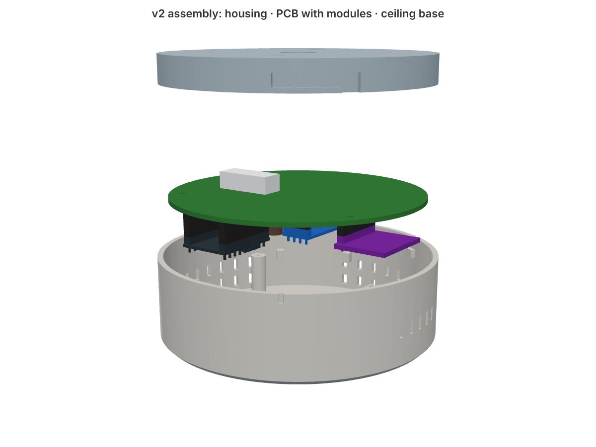
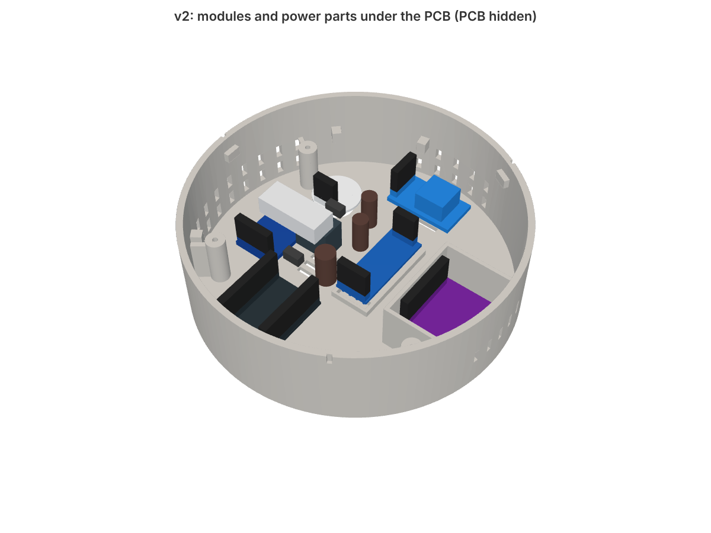
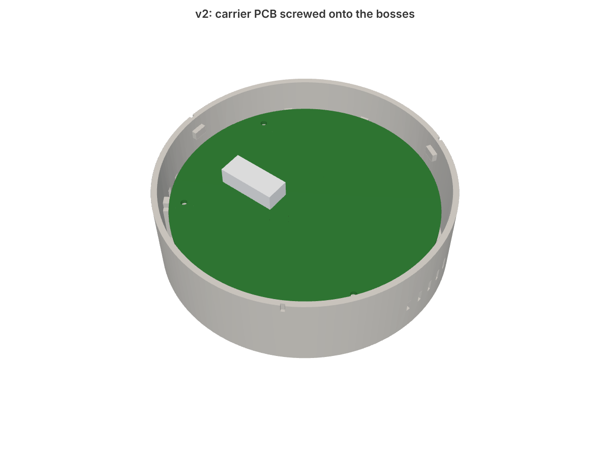
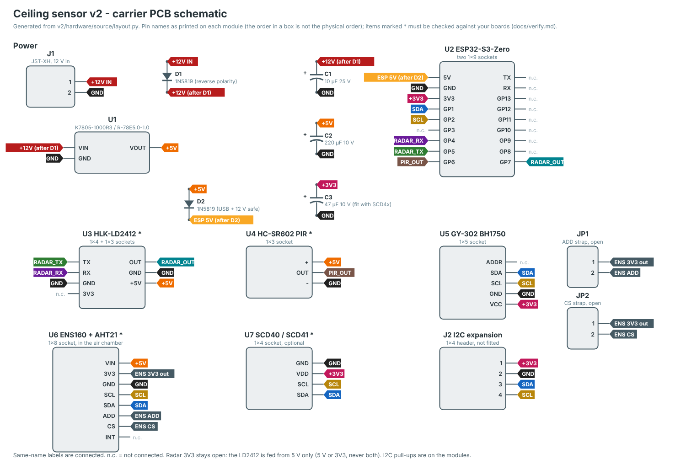

# v2: carrier PCB (Ø100)

> **Status: designed, not built.** Nothing in this folder has been ordered, printed or tested yet. Several module dimensions come from product photos, not from a caliper. Go through [verify.md](docs/verify.md) before you order boards.

v1 works, but wiring it is fiddly: about twenty jumpers, a hand-made Dupont hub, and a radar with 1.27 mm pads. v2 puts all of that on a round two-layer PCB. Every module plugs into a female socket on the underside of the board, the board goes into the housing as one piece, and three M2 screws hold it.



## What changes compared with v1

| | v1 | v2 |
|---|---|---|
| Wiring | Jumpers + a perfboard hub | Carrier PCB, modules plug in |
| Radar | HLK-LD2410B, 1.27 mm pads | HLK-LD2412, 2.54 mm pins, longer range, better at still people |
| Power | S09 module, EN bridged by hand, capacitor on its pads | 3-pin switching regulator (K7805-1000R3 or any pin-compatible 7805 replacement) on the board |
| 12 V input | Wago | Keyed JST-XH connector, plus a diode against reverse polarity |
| USB + 12 V together | Not allowed | Allowed (a diode separates the ESP from the 5 V rail) |
| CO2 | eCO2 estimated from VOCs | Optional SCD40/SCD41 socket for real CO2 |
| Housing | Ø80 or Ø100 | Ø100 only; same ceiling base and bayonet as v1 |
| ESP | On the face | Under the PCB, in a socket: unplug it to flash over USB |

The PIR, BH1750, ENS160+AHT21 and ESP32-S3-Zero are the same boards as in v1.

| Modules under the PCB (PCB hidden) | Assembled |
|---|---|
|  |  |

## Order of work

1. Buy the parts: [bom.md](docs/bom.md).
2. Check the parts against the design: [verify.md](docs/verify.md). Print `20_pcb_fit_template.stl` and the housing first, then plug the modules in through the template.
3. Order the PCB (five boards cost about 10 USD including the cheapest shipping to Poland): [pcb.md](docs/pcb.md).
4. Solder sockets and power parts, flash the ESP, plug in the modules: [assembly.md](docs/assembly.md).
5. Firmware: [firmware.md](docs/firmware.md).

## Files

```
v2/firmware/          ESPHome config for v2 (+ optional scd4x.yaml)
v2/hardware/pcb/      KiCad board (carrier.kicad_pcb, KiCad 7 or newer)
v2/hardware/gerber/   Gerbers + drill files, zipped for JLCPCB
v2/hardware/stl/      housing, ceiling base, PCB fit template
v2/hardware/step/     the same as STEP
v2/hardware/source/   layout.py (positions, pins, nets) and the scripts that build the board,
                      the housing and the drawings from it
v2/docs/              documentation and images
```

`layout.py` is the only place where module positions, pin orders and nets are written down. The PCB, the housing, the schematic and the assembly drawing are all generated from it, so if a module turns out different, you fix one file and rebuild everything (see [verify.md](docs/verify.md)).


