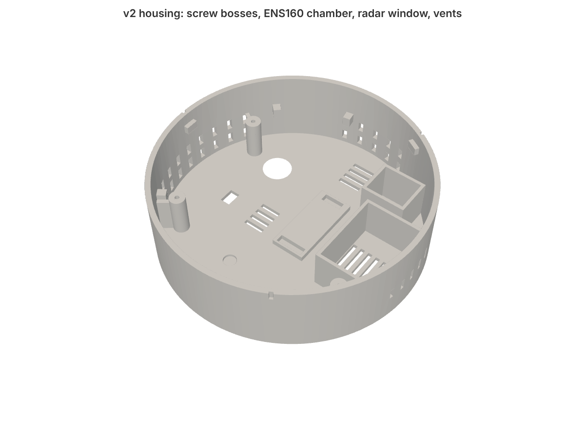
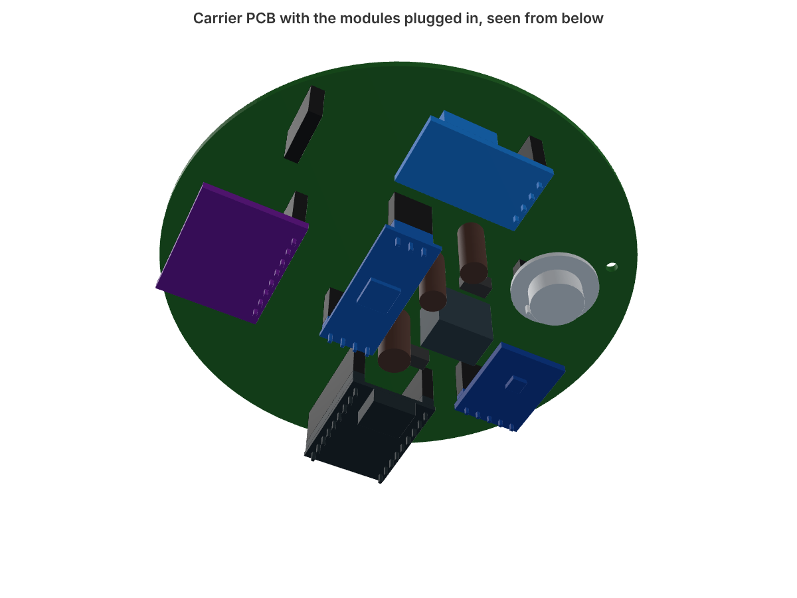
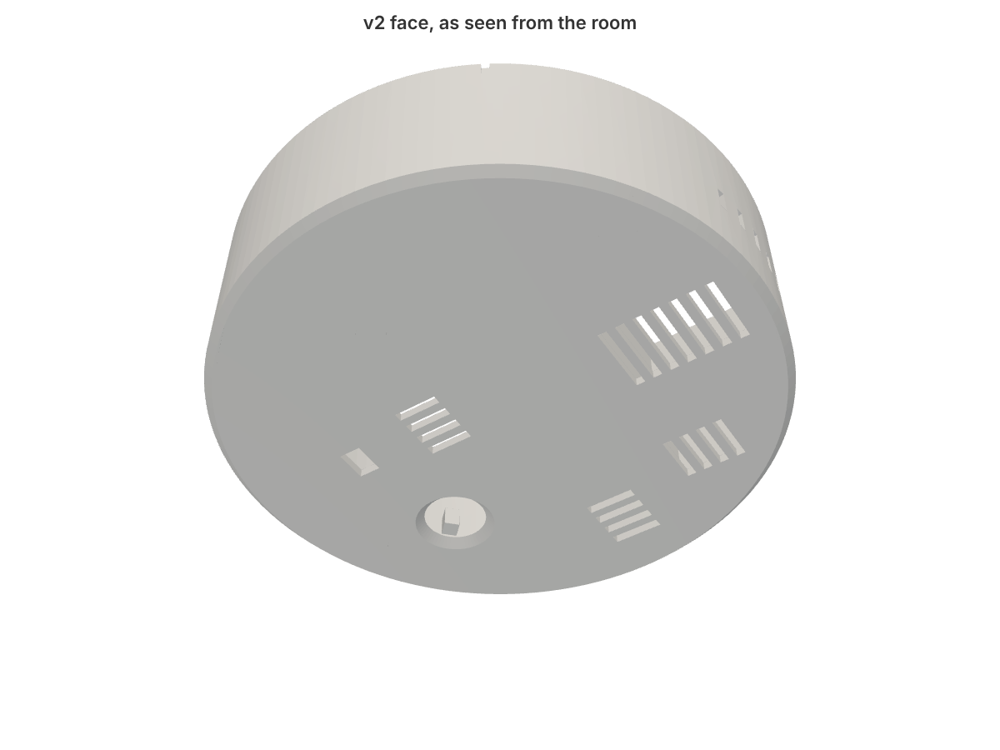

# v2 assembly

## 1. Print

Same material and settings as v1 ([printing](../../docs/printing.md)): PETG, 0.16 mm layers, face down, no supports.

| File | What |
|---|---|
| `hardware/stl/01_housing_v2.stl` | the housing |
| `hardware/stl/02_ceiling_base.stl` | ceiling base, identical to v1 Ø100; reuse one you already printed |
| `hardware/stl/20_pcb_fit_template.stl` | optional, for the fit test in [verify.md](verify.md) |

## 2. Solder the PCB

See [pcb.md](pcb.md#soldering). Do the meter checks there before any module goes in.

## 3. Flash the ESP

Pull the ESP out of its socket and flash it over USB, as in v1, with [`firmware/ceiling-sensor-v2.yaml`](../firmware/ceiling-sensor-v2.yaml) ([firmware.md](firmware.md)). After that, updates go over Wi-Fi.

With the ESP in its socket a USB-C plug doesn't fit: C2 hangs right in front of the port. If you ever need USB with the board assembled, a right-angle USB-C plug may go in. D2 makes it electrically safe to have USB and 12 V connected at the same time. On USB alone only the ESP gets power: the radar, PIR and ENS160 run from the 5 V converter, so connect 12 V when you want to see sensor readings.

## 4. Plug the modules in

Hold the board underside up. The silkscreen names every socket pin; match it with the module's own labels.

| Module | Faces | Check |
|---|---|---|
| ESP32-S3-Zero (U2) | components and USB-C away from the board | USB-C points to the board centre |
| LD2412 (U3) | antenna and chip away from the board | OUT/GND/+5V end towards the SCD4x, TX/RX/GND/3V3 end towards the ESP |
| HC-SR602 (U4) | lens away from the board | + and − on the silkscreen match the module |
| GY-302 (U5) | light sensor away from the board | pin row towards the ESP |
| ENS160+AHT21 (U6) | components **towards** the board | sits inside the chamber outline |
| SCD40/41 (U7, optional) | sensor **towards** the board | pin column on the PIR side |
| GY-SHT40 (U8) | sensor away from the board | sits inside the small pocket outline next to the chamber |

Push every module all the way down: the header plastic should touch the socket. The module heights in the housing (radar 2 mm above its window, PIR lens in its hole) depend on that.

## 5. Into the housing

1. Line the three screw holes up with the bosses. Only one orientation matches: the ENS160 lands in the closed chamber, the PIR over its round hole.
2. Lower the board straight down. The PCB is smaller than the bayonet pins' circle, so it passes them.
3. Three M2 × 6 self-tapping screws into the bosses. Snug is enough; PETG strips if you overtighten.
4. Plug the 12 V lead into J1 (keyed, it only goes in one way).

## 6. Ceiling

Exactly as v1 ([assembly](../../docs/assembly.md#3-ceiling-mount)): base on the ceiling, 12 V cable through the centre hole, plug into J1, twist the housing on.

What the face has, from the room side: the radar window (3.7 mm of plastic, no holes), the PIR lens hole, a small window for the BH1750, a thin spot that lets the ESP's RGB LED glow through, the ENS160 chamber grille, the SHT40 pocket grille, a grille under the SCD4x and one under the power parts.
