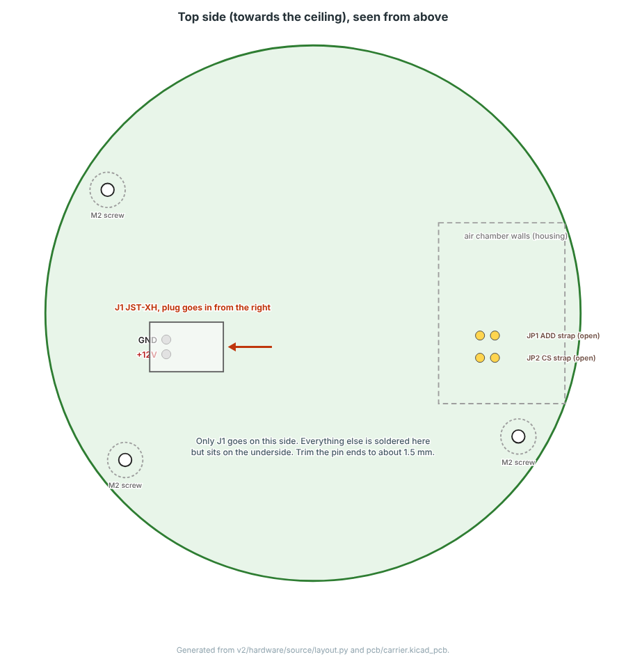
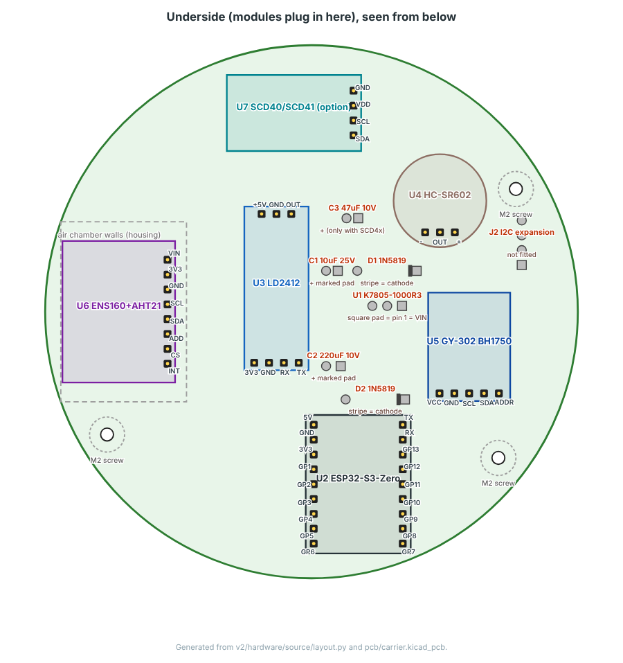
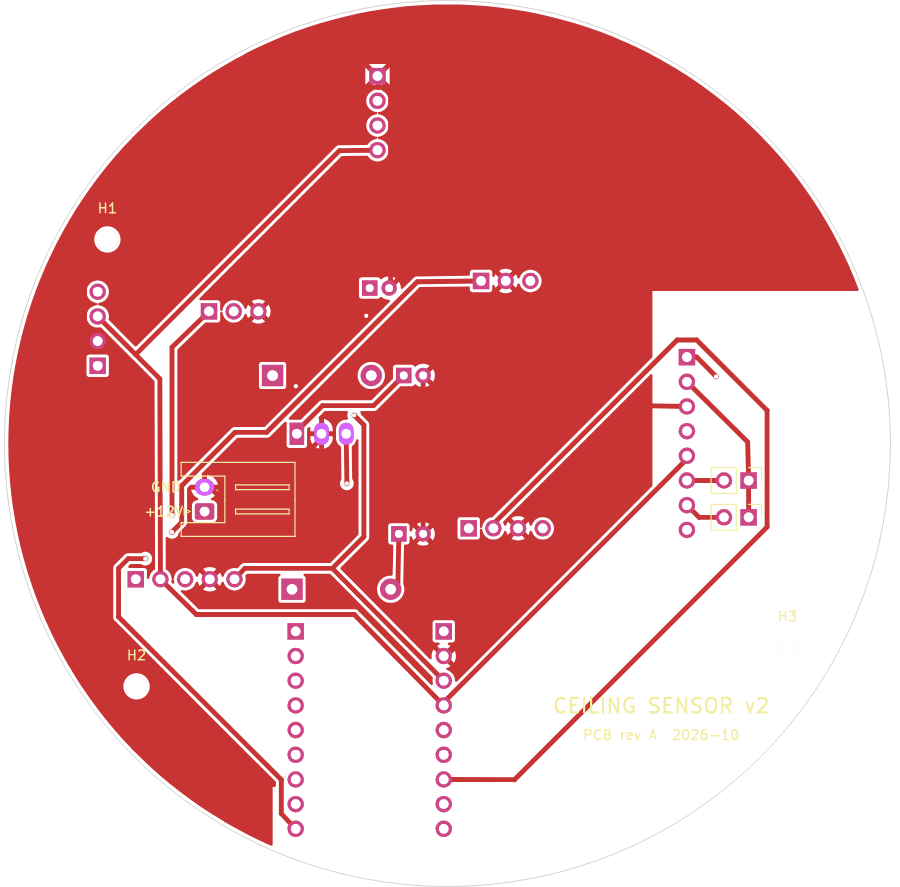
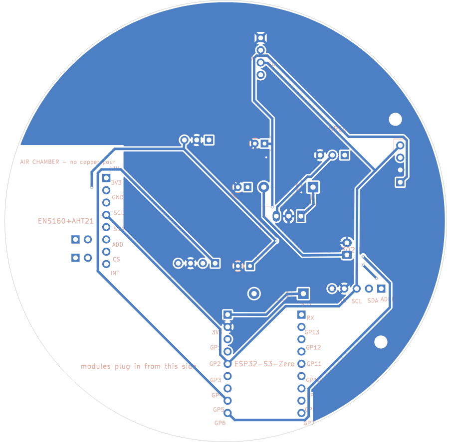

# Ordering and soldering the PCB

## Ordering (JLCPCB)

Upload [`hardware/gerber/carrier_v2_gerbers_jlcpcb.zip`](../hardware/gerber/carrier_v2_gerbers_jlcpcb.zip) at jlcpcb.com. The defaults are right:

| Option | Value |
|---|---|
| Layers | 2 |
| Dimensions | detected from the outline, 91.2 × 91.2 mm (round) |
| Thickness | 1.6 mm (the housing is designed around it) |
| Surface finish | HASL is fine |
| Colour | any |
| Assembly | none: every part is through-hole |

In October 2026 five boards cost 4 USD, plus about 6.5 USD for the cheapest shipping to Poland (10-12 working days) or about 23 USD with DHL (2-4 days). VAT may be added at checkout.

Any other fab that takes Gerbers works the same way.

## The board

| Top (towards the ceiling) | Underside (modules plug in here) |
|---|---|
|  |  |

Copper, top and bottom:

| Top | Bottom (mirrored, as seen from below) |
|---|---|
|  |  |

- Two layers, ground pour on both, 0.5 mm tracks, 0.25 mm clearance.
- No copper pour over the ENS160 air chamber, so heat from the rest of the board doesn't creep into it, and none above the ESP32-S3-Zero's antenna end.
- No copper under the screw bosses.
- KiCad's DRC reports no errors and no unconnected pads. The only warnings are silkscreen text clipped by pads and "library not in the configuration" (the footprints are stock KiCad ones or generated by the script).

## Soldering

Everything except J1 sits on the underside and is soldered from the top.

1. **Female sockets first.** Plug each socket onto its module's header, set the module with the socket onto the board, and solder one pin. Check that it stands straight, then solder the rest. This way the sockets end up exactly where the module pins are.
2. **D1, D2** lying flat, stripe (cathode) on the square pad.
3. **U1**, standing, pin 1 (VIN) in the square pad.
4. **C1, C2** (and **C3** if you fit the SCD4x), long leg (+) in the square pad.
5. **J1** on the top side, opening towards the board centre.
6. Trim the pin ends on the top side to about 1.5 mm. Clip the ESP socket pins at the end away from USB-C a little shorter: they are the ones closest to the edge, and the ceiling base ring turns 0.7 mm above the board about 1 mm further out.
7. **JP1, JP2** (top side, above the air chamber) stay open. They tie the ENS160's ADD and CS pins to its own 3.3 V. The usual combo boards already pull both up, and the v1 prototype answered at 0x53 with them unconnected. Bridge them with a blob of solder only if the ENS160 doesn't show up in the I2C scan.

Before plugging anything in, measure with a meter:
- between +12V and GND on J1: no short;
- 12 V on J1: about 5.0 V between the +5V and GND pins of the LD2412 socket, about 4.7 V on the ESP 5V socket pin, and 0 V everywhere when the 12 V plug is reversed.

## Rebuilding the board

The board file is generated, see [verify.md](verify.md). To export Gerbers after a rebuild:

```bash
cd v2/hardware
kicad-cli pcb export gerbers --layers F.Cu,B.Cu,F.SilkS,B.SilkS,F.Mask,B.Mask,Edge.Cuts \
    --subtract-soldermask --no-x2 -o gerber/jlcpcb/ pcb/carrier.kicad_pcb
kicad-cli pcb export drill --format excellon --excellon-separate-th --excellon-units mm \
    -o gerber/jlcpcb/ pcb/carrier.kicad_pcb
(cd gerber/jlcpcb && zip ../carrier_v2_gerbers_jlcpcb.zip *)
```
